# Lab 4: Secure Connect and Communication Platform

A secure backend API with authentication, protected notes, role-based access, real-time chat, and event-driven logging.

## Technology

- Node.js and Express
- MongoDB and Mongoose
- bcrypt for password hashing
- JSON Web Tokens (JWT) for authentication
- Socket.IO for real-time chat
- dotenv for environment variables

## Features

- User signup and login
- Hashed passwords and JWT authentication
- Protected routes and role-based access control
- Private Notes CRUD: each user can access their own notes
- Admin-only notes route
- Authenticated real-time chat
- EventEmitter logs for account, note, and chat events

## Setup

Requirements: Node.js, npm, and MongoDB running locally.

1. Install dependencies:

   ```bash
   npm install
   ```

2. Create a `.env` file in the project root:

   ```env
   PORT=5001
   MONGO_URI=mongodb://127.0.0.1:27017/secure_connect_db
   JWT_SECRET=add_your_own_private_random_secret
   JWT_EXPIRES_IN=86400
   ```

3. Start the server:

   ```bash
   npm run dev
   ```

The API runs at `http://localhost:5001`.

## REST API

Auth endpoints do not need a token. Notes endpoints require `Authorization: Bearer <token>` unless marked otherwise.

| Method | Endpoint | Purpose |
|---|---|---|
| GET | `/` | Check that the API is running |
| POST | `/api/auth/signup` | Register a user |
| POST | `/api/auth/login` | Log in and receive a JWT |
| GET | `/api/notes` | List the signed-in user's notes |
| POST | `/api/notes` | Create a note |
| GET | `/api/notes/:id` | Get one of the signed-in user's notes |
| PUT | `/api/notes/:id` | Update one of the signed-in user's notes |
| PATCH | `/api/notes/:id` | Partially update a note |
| DELETE | `/api/notes/:id` | Delete one of the signed-in user's notes |
| GET | `/api/notes/admin/all` | Admin-only list of all notes |

## Real-Time Chat

Connect with Socket.IO at `ws://localhost:5001` and send the JWT in the `Authorization` header as a Bearer token.

Supported events:

- `chat:join` — join a room such as `general`
- `chat:message` — send a message with `room` and `content`
- `chat:typing` — notify the room that a user is typing
- `chat:connected` — server confirms the connection
- `chat:user-joined` — server announces a room participant
- `chat:message` — server broadcasts a message to the room

## Event-Driven Logs

The Node.js EventEmitter logs user registration, note creation/update/deletion, and chat messages in the server terminal. Passwords, note contents, and chat contents are not logged.

## Postman Screenshots

### Health check
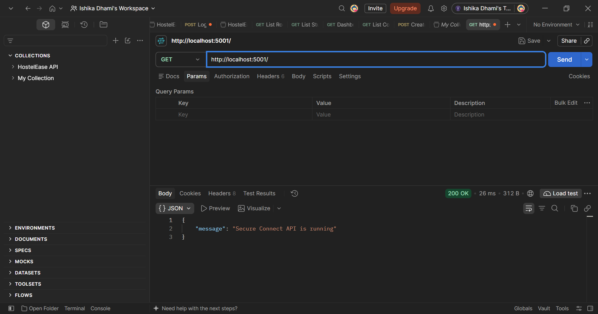

### Signup and login
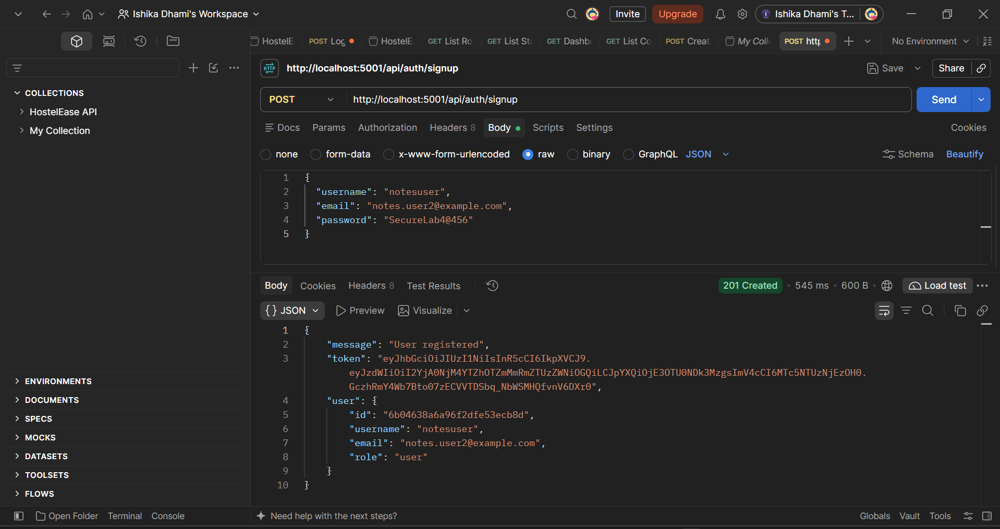


### Protected Notes API
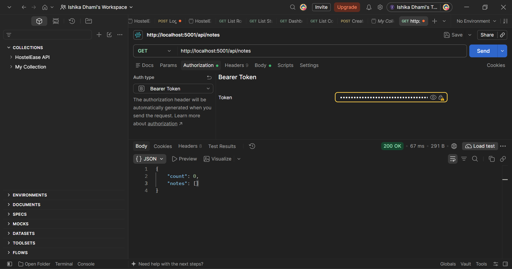
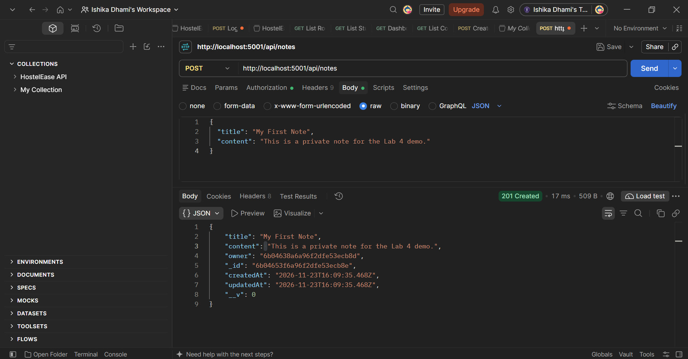
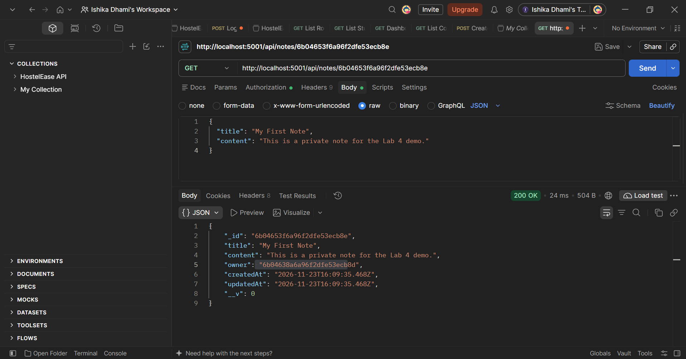
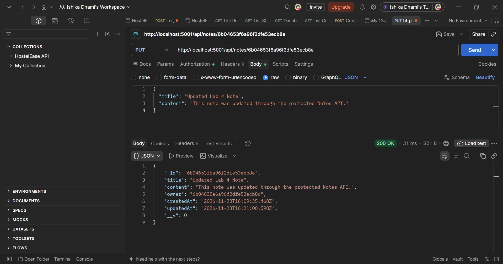
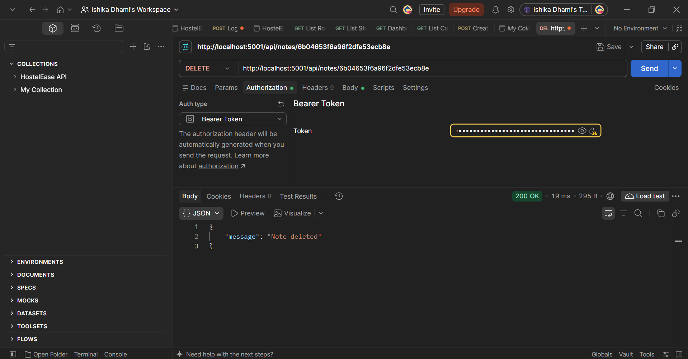

### Access control
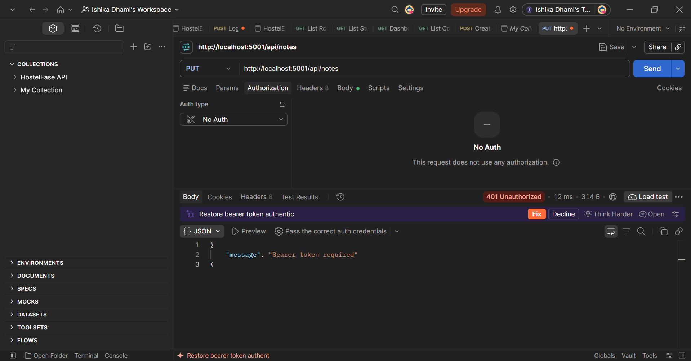
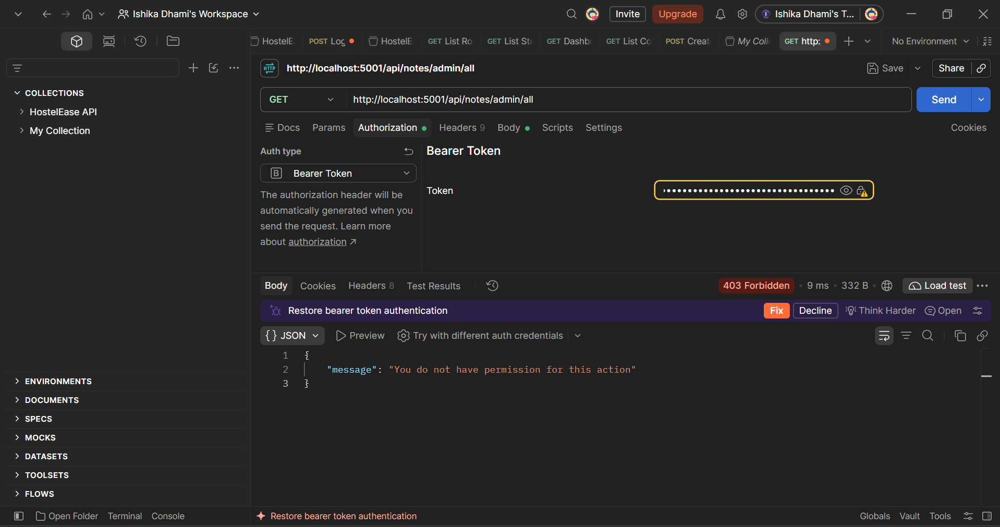

### Socket.IO and EventEmitter
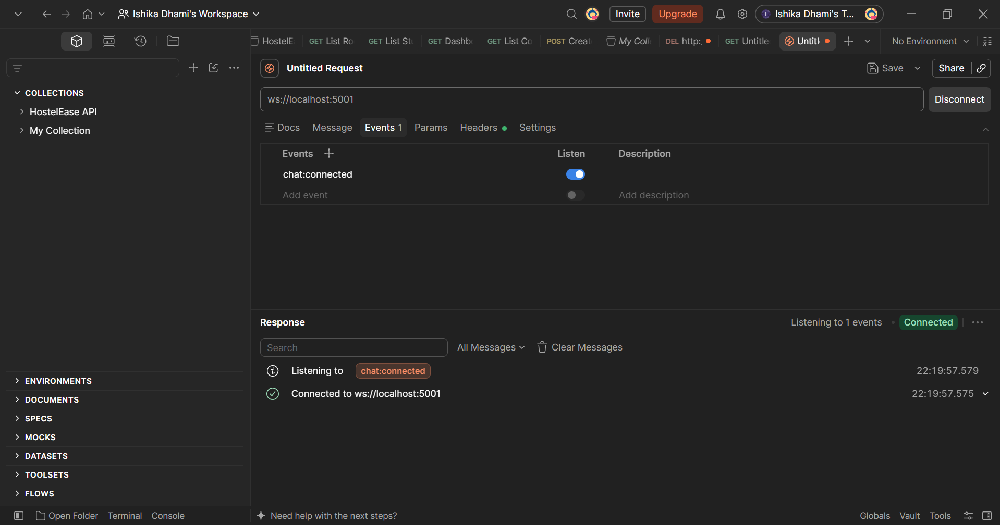
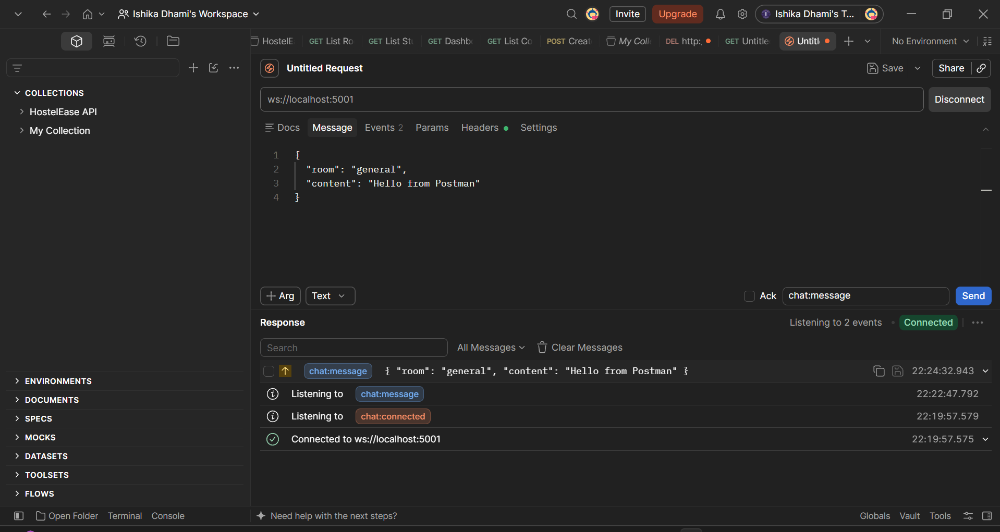
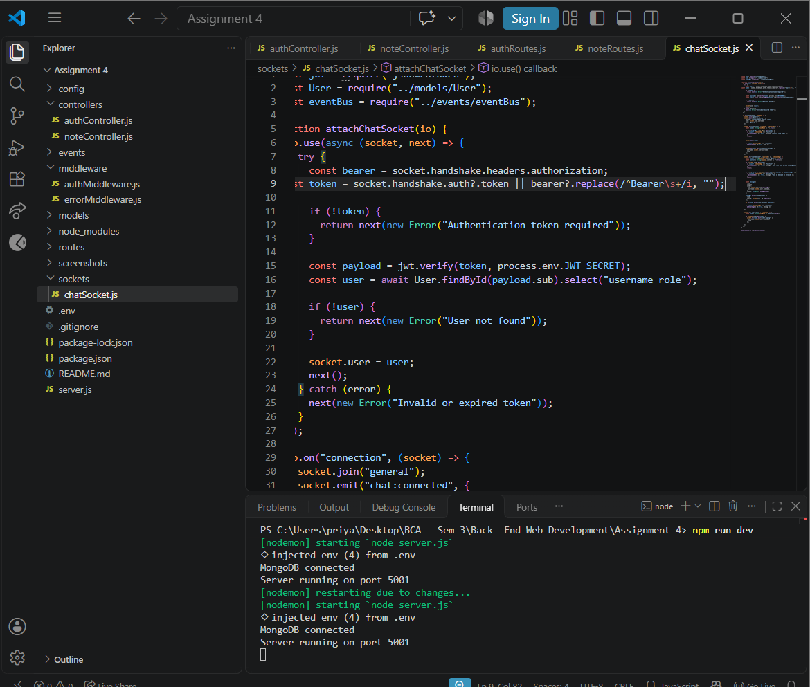